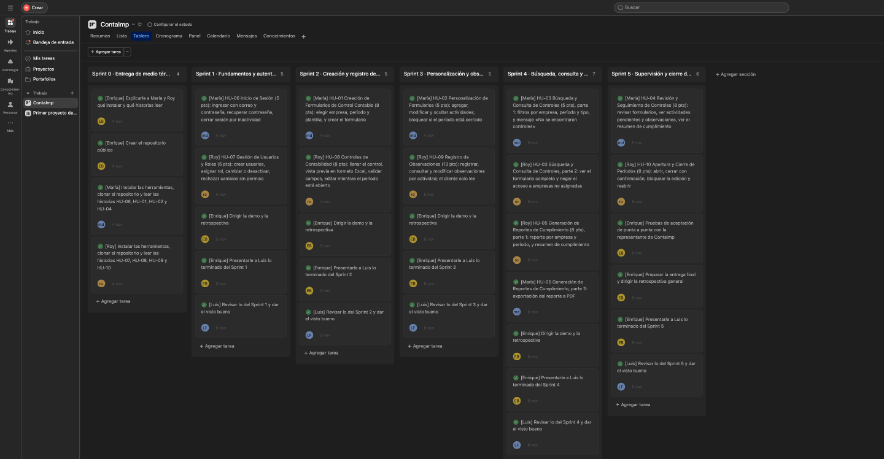

# Metodología: Scrum

Este proyecto se desarrolló con el marco de trabajo ágil Scrum, en la materia Ingeniería de Software I (ESPOL). En esta carpeta están las evidencias de cómo se aplicó.

## Roles

| Integrante | Rol |
|---|---|
| Luis Daniel Flores Feijoó | Product Owner |
| Enrique Haziel Barco Manobanda | Scrum Master |
| Roy Eliecer García Erazo | Desarrollador |
| María de Lourdes Durango Tumbaco | Desarrolladora |

## Herramientas

- **Asana:** tablero del proyecto, con una sección por sprint (de Sprint 0 a Sprint 5). Cada tarea lleva el nombre de quien la hace y una fecha.
- **Planning Poker (planningpokeronline.com):** estimación de las historias de usuario con la escala 1, 2, 3, 5, 8 y 13.
- **Google Sheets:** cálculo de la velocidad del equipo y gráfico de burndown. [Ver hoja de cálculo](https://docs.google.com/spreadsheets/d/1giNVF3wzFhfvewWdO6syHfl1lruBDaRaUrpBVYYN5Ow/edit?usp=sharing)
- **Figma:** prototipo del sistema. [Ver prototipo](https://www.figma.com/design/pg0gqm5iDxsCffSHMGGkir/Contaimp-Controller-App-%E2%80%94-Gu%C3%ADa-del-equipo?node-id=5-9)

## Resumen del plan

El backlog tiene 10 historias de usuario, con un total de 73 puntos.

La velocidad promedio simulada es de 14,7 puntos por sprint. Con 73 puntos, el equipo necesita 5 sprints (73 / 14,7 = 4,97).

| Sprint | Historias | Puntos |
|---|---|---|
| 1 | HU-06, HU-07 | 10 |
| 2 | HU-01, HU-08 | 16 |
| 3 | HU-02, HU-09 | 18 |
| 4 | HU-03, HU-05 | 13 |
| 5 | HU-04, HU-10 | 16 |
| Total | | 73 |

El Sprint 0 corresponde a la entrega del documento de especificación de requerimientos, el repositorio y el prototipo.

## Contenido de la carpeta

- `Workshop 3 - Grupo 1.pdf`: informe del taller, con el tablero de Asana, el backlog, la estimación con Planning Poker, la velocidad, el número de sprints, el burndown y la reflexión del equipo.
- `asana_tablero.png`: captura del tablero de Asana.
- `README.md`: este archivo.

## Enlace al tablero de Asana

El tablero requiere invitación, porque la cuenta gratuita de Asana no permite un enlace abierto. Por eso se incluye una captura del tablero.

Enlace al tablero:

https://app.asana.com/1/1219878129769925/project/1220228279089132/board/1220228279089147
